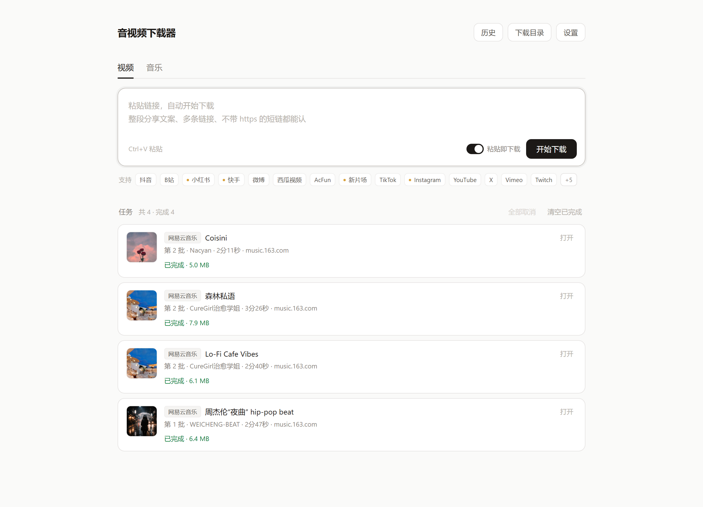

# 音视频下载器

粘贴链接就下载。不是 exe，不需要安装，在被管控的电脑上也能开。

一个跑在本机的下载工具：Python 起一个 `127.0.0.1` 的本地服务，用 Edge/Chrome 的应用模式把它包成一个没有地址栏的独立窗口。视频和音乐都在同一个界面里。



## 它能干什么

- **粘贴即下载**：一次可以粘多条链接，回车就排进队列
- **抖音图文作品**：网格预览、单张另存、勾选打包成 ZIP
- **并发队列**：可调并发数，支持取消、重试（单条或一键重试所有失败）、清空已完成
- **任务筛选**：全部 / 进行中 / 失败 / 已完成，一堆任务里先看有问题的那几条
- **窗口标题看进度**：最小化也能从任务栏看到「↓ 2/5」或「⚠ 3 项失败」，跑完闪一下「✓ 已完成」
- **失败原因说人话**：「视频不可用：已删除、私密或地区限制」而不是 `HTTP Error 403`，悬停能看原始报错
- **下载历史**：任务记录落盘，可按标题/作者搜索，点一下定位到文件，可导出 CSV
- **命名模板**：`{date}_{platform}_{author}_{title}` 这样自由组合
- **顺手存封面**：多一张同名 `.cover.jpg`，做参考板用
- **弹幕与简介**：B站弹幕存成同名 `.xml`（3600 条那种也是几十 KB），标题/作者/链接/简介写成同名 `.txt`，剪辑时找参考不用回网页翻
- **B站字幕**：有 CC 字幕就一起下成 `.srt`
- **附件归拢**：封面/字幕/弹幕/简介收进一个跟视频同名的文件夹（文件夹跟着命名模板走），下载目录里还是一排视频
- **文件级去重**：下过且文件还在，再贴会直接告诉你，不重复占空间
- **断点续传**：下到一半断网 / 取消 / 关程序，点「重试」从断点接着下，不重头来。半截文件都是 `.part`，不会顶着正式文件名混进下载目录
- **音乐下载**：网易云、QQ音乐、酷狗搜索 + 下载，mp3 自动写入歌名/歌手/专辑/封面标签，搜完可勾选多首一起批量下
- **搜视频素材**：搜索页直接搜 B站 / YouTube（关键词 → 结果卡 → 点下载），不用先开网页找链接
- **会员账号**：贴自己的网易云 / QQ音乐 cookie，走你自己账号的权限——会员能下无损 FLAC，VIP 曲也能下。贴进去会验证并显示昵称和会员等级，过期了标「已失效」
- **两种打开方式**：独立窗口（默认）或普通浏览器标签

## 支持平台

| 平台 | 视频 | 音乐 | 说明 |
|---|:---:|:---:|---|
| 抖音 | ✅ | | 视频 + 图文作品，无水印 |
| 小红书 | ✅ | | 需登录 Cookie |
| B站 | ✅ | | 支持 CC 字幕 |
| 快手 | ⚠️ | | 实验性 |
| 微博 | ✅ | | |
| 西瓜视频 | ✅ | | |
| AcFun | ✅ | | |
| 新片场 | ⚠️ | | 实验性 |
| YouTube / TikTok / X / Vimeo / Twitch / Reddit / Instagram | ✅ | | 走 yt-dlp，Instagram 需 Cookie |
| 视频号 | ⚠️ | | 别人的视频下不了（微信限制）；自己的作品走视频号助手，或粘直链 / 接解析接口，见下 |
| 网易云音乐 | | ✅ | 免登录下免费曲目（320k）；贴会员 cookie 可拿无损和 VIP 曲 |
| QQ音乐 | | ✅ | 必须登录（vkey 按账号下发）；会员 cookie 可拿无损 FLAC |
| 酷狗音乐 | | ⚠️ | 只做了搜索，播放地址拿不到 |
| Suno | | ✅ | 贴分享链接；下 mp4 抽音轨转 mp3，需 ffmpeg |
| 直链 / HLS | | ✅ | 任意 `.m3u8` / `.mp4` 地址，多码率自动挑最高 |

✅ 直接可用　⚠️ 有条件可用

## 快速开始

**Windows**

1. 装 [Python 3.11+](https://www.python.org/downloads/)（安装时勾选 Add to PATH）
2. 装依赖：`pip install -r requirements.txt`
3. 双击 **`诊断.bat`**

   （这个文件同时是排障用的：前台运行，报错会留在窗口里，方便截图发出来）

窗口会自己弹出来。关掉窗口就等于退出，不会在后台留进程。

也可以走命令行：

```bash
python server.py --app     # 独立窗口（默认）
python server.py --web     # 普通浏览器标签
python server.py --server  # 只起服务，不动浏览器
```

**macOS**

1. 装 Python 3.9+：`brew install python@3.12`（或去 python.org 下安装包）
2. 装下载内核和 ffmpeg：

```bash
python3 -m pip install --user yt-dlp
brew install ffmpeg
```

   如果 pip 报 `externally-managed-environment`，加一个 `--break-system-packages`。
3. 双击 **`启动.command`**

首次双击可能提示「无法打开，因为来自身份不明的开发者」——右键点它 → 打开 → 再点一次「打开」就放行了；也可以在终端里 `chmod +x 启动.command`。

独立窗口靠 Chrome / Edge / Chromium / Brave 的应用模式实现（Safari 不支持）。只装了 Safari 的机器会退化成普通浏览器标签页，功能一样，只是多一条地址栏。系统「选择文件夹」在 mac 上走的是原生面板。

**Linux**

`python3 server.py --web` 就能跑；装了 Chromium 系浏览器的话 `--app` 也能开独立窗口。

## 怎么用

**下视频**：复制分享链接 → 粘到输入框 → 回车。抖音的图文作品会自动变成网格，可以逐张保存或者打包。

**下音乐**：切到顶部「音乐」标签，选平台、输入歌名、回车，点结果右边的「下」。mp3 写好了 ID3 标签，放到播放器或资源管理器里能看到封面和歌名。

**改设置**：右上角「设置」——下载目录、清晰度、命名模板、并发数、代理、Cookie。第一次下载会弹窗让你选目录。

**找以前的**：右上角「历史」——按标题或作者搜，点一条直接在资源管理器里定位；「导出 CSV」会把所有记录写成表格，带 BOM，Excel 打开不乱码。

## 账号与会员

右上角「账号」里每个平台一行。两种登录方式，任选：

- **点「登录」**：弹一个真浏览器窗口，扫码或输账号，登录完成后自动存下来。
- **点「粘贴」**（只有网易云和 QQ音乐有）：不想开窗口，就把浏览器里已登录的 cookie 复制过来。

贴 cookie 的做法，很土但最快：

1. 浏览器打开 `music.163.com` 并登录（QQ音乐是 `y.qq.com`）
2. 按 `F12` → `Application`（应用）→ `Cookies` → 选对应域名
3. 找到 `MUSIC_U`（QQ音乐是 `qm_keyst` 和 `uin`），把「名字=值」复制出来
4. 粘进弹层保存，或者干脆用 Cookie-Editor 这类插件「Export → Copy」，整段贴进来

保存后会立刻验证：显示这个号的昵称，会员会带「黑胶VIP / 绿钻」标记。**cookie 过期了会标红「已失效」**，不是默默失效。

音质跟着「设置 → 清晰度」走：

| 设置 | 有会员 cookie | 没 cookie |
|---|---|---|
| 最高画质 | 无损 FLAC（拿不到自动降 320k） | 320k mp3 |
| 720p 及以下 | 320k mp3 | 128~320k mp3 |

cookie 只存在本机 `cookies/music_*.txt`，不上传、不共享。用的是**你自己付过钱的账号**，下的是自己有权备份的内容。

> 无损 FLAC 不写 ID3 标签（格式不支持），文件名里带歌名和歌手。mp3 照常写封面和标签。

## 配置

配置文件是 `config.json`，界面里改就行；它不入库（含本机路径），首次保存设置时自动生成。

| 字段 | 说明 |
|---|---|
| `out_dir` | 视频下载目录 |
| `music_dir` | 音乐单独存放目录，留空则跟视频同目录 |
| `quality` | `best` / `1080` / `720` / `audio` |
| `name_tpl` | 命名模板，支持 `{date}` `{platform}` `{author}` `{title}` `{id}` 等 |
| `save_cover` | 是否同时保存封面图 |
| `concurrency` | 同时下载几个任务 |
| `proxy` | 代理地址，留空则自动读系统代理 |
| `cookies_file` | 自定义 cookies 文件路径 |
| `sph_api` | 视频号解析接口地址 |

### 视频号

先说结论：**别人的视频号视频，网页端拿不到播放地址**。这不是没做，是微信的设计——
分享链接在浏览器里打开是白页（实测：`weixin.qq.com/sph/xxx` 会 302 到
`channels.weixin.qq.com/finder-preview/pages/sph?id=xxx`，这个预览页在非微信环境里
不发任何播放请求，DOM 是空的），视频流只发给微信客户端，且带解密 key。
所以「扫码登录一下就能下别人的视频」这条路物理上不存在。

**自己的作品**可以下，而且是官方原片：设置里点「打开视频号助手」→ 扫码登录 →
内容管理 → 已发布 → 某条右边「更多」→「下载视频」。

软件本身还能干这两件事：

1. 直接粘 `finder.video.qq.com/.../stodownload?...` 这类直链（带 key 的那种能下）
2. 在设置里填一个解析接口（POST `{"url": "分享链接"}`，返回里含 `stodownload` / `.mp4` / `.m3u8` 即可）
   —— 接口现在收在「高级设置 → 视频号 → 我有解析接口」里，不填就不占地方

解析接口从哪来：

- 用任意解析工具把分享链接换成直链再粘，接口留空
- 自己照接口约定搭个小服务；开源工具 [wx_channels_download](https://github.com/ltaoo/wx_channels_download) 自带解析服务（走的是注入微信客户端那条路），也支持一键部署成 Cloudflare Worker
- 用同事 / 服务商给的现成接口地址

仓储里没有内置任何第三方解析服务，也不打算接。

### Suno

贴分享链接就能下，三种形式都认：

```
https://suno.com/s/IdazmB1kcRTOjU5p          短链
https://suno.com/song/6cf789dd-73ae-4f9c-... 完整页
https://cdn1.suno.ai/{uuid}.mp4              视频直链
```

短链会跟一次 302 取出歌曲 uuid，然后打公开接口
`https://studio-api.prod.suno.com/api/clip/{uuid}/`（不需要登录、不需要 cookie），
拿标题、作者、封面、标签、歌词。

音频这块要说清楚，Suno 现在把直接下载关掉了：

- `audio_url` 对游客有时返回 `https://studio-api.prod.suno.com/api/forbidden`
- `cdn1.suno.ai/{uuid}.mp3` 要 CloudFront 签名，裸链 403 `MissingKey`
- 页面里那条 m4a（`d2lwuy8qc234o3.cloudfront.net`）是 AES 加密的，下下来是乱码

能用的是 `video_url` 指向的 mp4：`https://cdn1.suno.ai/{uuid}.mp4`，实测
824x1464 竖屏 H.264 + **197kbps AAC 48kHz 立体声**，不加密、不用登录。
所以流程是「下 mp4 → 抽音轨」：

- 机器上有 `ffmpeg` → 转成 192k mp3，歌名/作者/封面写进 ID3
- 没有 `ffmpeg` → 留 mp4 原文件（剪映能直接分离音频）

**下载会按这个顺序挨个试，第一个成功的就用**（1.9.1 起）：

1. `audio_url`（有登录 cookie 时是签名好的 mp3，音质最好）
2. `video_url`（mp4）
3. `cdn1` / `cdn2` 的 `{uuid}.mp4`（接口没给地址时兜底）
4. 分享页 HTML 里的媒体地址（页面播放器自己用的，签名通常有效）

踩过的坑：S3 对**不存在的文件返回 403 `AccessDenied`**，不是 404。
所以别把 403 一律当成「作者限制了下载」——新歌视频还没渲染好、
或者这首只对登录用户开放，表现出来的都是同一个 403。界面上会写清楚
试过哪些、建议怎么处理，长细节放在鼠标悬停的提示里。

**便携版已经把 `ffmpeg.exe`（97MB）打进去了**，放在 `程序\bin\` 下，
`tools/build_portable.py` 打包时会自动从系统里找一份复制进去。
所以发给别人也不用对方装任何东西。查找顺序：
`程序\` → `程序\bin\` → `程序\runtime\` → 系统 PATH。

Suno 是境外站，没在设置里填代理时会自动走系统代理，所以浏览器能打开就能下。
如果 `cookies/suno.txt` 存在（自己把登录 cookie 存进去），请求会带上它，
私有 / 分享链接的音频往往就能拿到。

### 直链 / HLS（m3u8）

任何 `.m3u8`、`.mp4`、`.mpd` 结尾的地址贴进来就能下，不需要对应的平台规则。

这块的判断顺序参考了浏览器嗅探扩展（猫抓 cat-catch）的做法，代码是自己写的：

1. `#EXT-X-STREAM-INF` 存在 → 多码率清单，按设置里的清晰度挑一档
   （`best` 取最高的；设成 `720` 就取不超过 720 的最高档）
2. 否则就是单码率切片列表，直接交给 ffmpeg
3. `#EXT-X-KEY` 的 AES-128、`#EXT-X-MAP` 的 fMP4 初始化段，ffmpeg 都认，
   不用自己写解密
4. 没装 ffmpeg 时退回纯 Python：下切片自己拼（只支持未加密的 TS/MP4）

进度按 `#EXTINF` 累加出的总时长算百分比，输出 `.mp4`，失败自动换 `.mkv` 再试一次。

**Referer 是这里的关键**：大部分 CDN 只认自己域名下的 Referer，
默认按 URL 的 origin 生成（`https://host/`），实测能过绝大多数站。
`yt-dlp` 的通用模式不会做这件事，所以直链没走它。

## 为什么不是 exe

公司电脑上 exe 经常被终端管控拦掉，而 `.bat` 和 `.py` 只是文本文件，不触发白名单审核。真正干活的 `python.exe` 和画窗口的 `msedge.exe` 都是机器上早就在跑的东西，我们只是让它们配合一下。

顺带的好处：

- 数据不出本机，`127.0.0.1` 只允许本机访问
- 断网也能开界面，只有真正下载时才需要网络
- 删掉文件夹就等于卸载干净，不写注册表

代价：依赖机器上有 Edge/Chrome 和 Python 3.11+，并且允许监听本地端口（默认从 8765 起，被占用会自动顺延）。

## 免安装便携版（给别人用）

源码目录不适合直接发给非技术同事：一堆 `.py`、三四个 `.bat`、没有图标。`tools/build_portable.py` 会把它打成一个干净的文件夹：

```
音视频下载器\
    音视频下载器.exe         ← 家用入口，带图标，双击即用
    音视频下载器-公司.lnk    ← 公司电脑入口，同样带图标，绕开被拦截的 exe
    下载的文件\              ← 下载保存位置
    使用说明.txt
    程序\                   ← 代码 + 内置 Python 运行时（隐藏，正常看不见）
        音视频下载器-公司.bat   ← 备份入口，换电脑导致快捷方式失效时用
        诊断.bat                ← 出问题排查用（前台运行，报错留在窗口里）
```

打包命令（需要 Pillow 和 PyInstaller）：

```bash
python tools/build_portable.py --dst "D:\Desktop\音视频下载器" \
    --runtime "C:\path\to\python"      # 拿来当内置运行时的 Python 目录
```

**为什么公司电脑要换一个入口，而且还要分 .lnk 和 .bat 两份**：公司那类装了端点安全软件的电脑，会把 PyInstaller 打包的 exe 直接拦掉（双击没反应，或者提示已阻止）。绕开的办法是直接拿内置的 `runtime\pythonw.exe` 起 `server.py --app`，功能完全一样。

但这里有两个 Windows 规矩绕不开：

1. `.bat` 文件自己没地方存图标资源，资源管理器只给它那个默认的齿轮窗口图标，改不了（除非改注册表把所有 `.bat` 的图标一起换掉，那是污染系统）。能带自定义图标的只有 exe 和快捷方式。
2. 快捷方式（`.lnk`）里存的是绝对路径，换台电脑、或者把文件夹改名搬走，就会提示「找不到目标」。

所以最终是两份：根目录放带图标的 `音视频下载器-公司.lnk`（`tools/make_shortcut.py` 用 ctypes 调 `IShellLink` 生成，图标指向 `程序\assets\icon.ico`，直接指向 `pythonw.exe`，**连黑框都不闪**）；`音视频下载器-公司.bat`（`tools/company_bat.py` 生成）放进 `程序\` 当备份，换电脑后快捷方式失效时用它——`pythonw` 是 GUI 子系统、没有控制台，bat 起完进程就 `exit`，黑框只闪 100 毫秒左右。

生成的 exe 只是个启动器（约 8.6 MB，PyInstaller 单文件），它找到旁边的 `程序\runtime\python.exe`，用无窗口方式拉起 `server.py --app` 就退出。所以：

- 双击后没有任何黑窗口
- 图标是 `tools/assets/icon.ico`（`tools/make_icon.py` 生成，改配色直接改脚本里三个常量）
- 整个文件夹可以整体拷走，对方不需要装 Python / ffmpeg
- 单独把 exe 放桌面也能用，它会按 `exe 旁边 → 下一层 → D:\Desktop\音视频下载器` 的顺序找 `程序`
- 启动失败会弹中文提示框，不会默默没反应

## 目录结构

```
server.py        本地 HTTP 服务、路由、窗口启动
core.py          平台识别、任务队列、抖音解析、yt-dlp 封装
music.py         网易云 / QQ音乐 / 酷狗，ID3 标签写入
search.py        视频素材搜索：B站（WBI 签名）/ YouTube（yt-dlp ytsearch）
cn_sites.py      快手 / 小红书专用解析
sph.py           视频号（直链 + 自定义接口）
suno.py          Suno（AI 音乐）分享链接解析，见下
hls.py           直链 / HLS(m3u8) 下载，多码率解析 + ffmpeg 拉流
login.py         账号登录，导出 cookies
picker.py        系统「选择文件夹」对话框（跨平台入口）
picker_win.py    Windows 那份实现（Win32 IFileOpenDialog）
web/             界面（原生 HTML/CSS/JS，无框架）
诊断.bat         Windows 排障入口（自带 Python 探测；web 参数走浏览器）
启动.command     macOS 的启动入口，双击运行
start.bat        旧的启动逻辑，仓库里留着，便携版不打包
使用说明.txt      给人看的说明书
tools/           打包用：图标生成、启动器、便携版打包脚本
tests/           回归自测：断点续传、分片拼接、端到端，改下载逻辑后跑一遍
```

## 已知限制

- 抖音的视频分辨率受签名保护，改参数会 403，只能拿到服务端给的那一档
- 做了这么多平台，风控随时会变，接口失效是常态，更新 `yt-dlp` 通常能救回大部分
- 断点续传靠 HTTP Range，个别 CDN 不支持 Range 时会自动重头下；Suno 转 mp3、ffmpeg 合并这类「下完还要加工」的步骤，中断了只能从下载那步接着来
- Apple Music 有 DRM，只能拿到 30 秒试听；Spotify 同理，不做

## 免责声明

本项目仅供个人学习、技术研究与**自己拥有版权或已获授权**的素材备份使用。

请遵守各平台的服务条款与所在地区的著作权法规，不要用于批量抓取、二次分发或任何商业用途。因使用本工具产生的一切后果由使用者自行承担。

## 检查更新

软件启动时会自动检查新版（设置 → 版本与更新），也可以随时手动检查。版本号见 [`version.txt`](version.txt)。

## License

**源码可用、禁止商用** —— 详见 [LICENSE](LICENSE)。简单说：

- ✅ 个人使用、学习研究、修改、免费再分发（保留协议与版权声明）
- ❌ 售卖、转售、有偿代下载、任何商业用途
- ❌ 移除版权声明、用于侵权或违法用途、恶意滥用接口

商业授权请提 Issue 联系。
